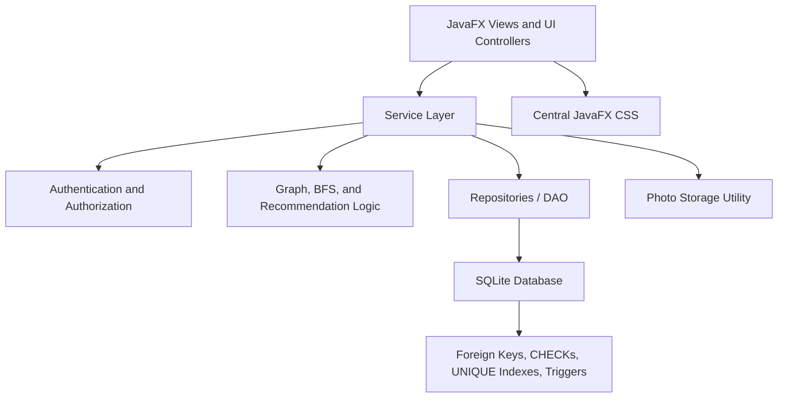
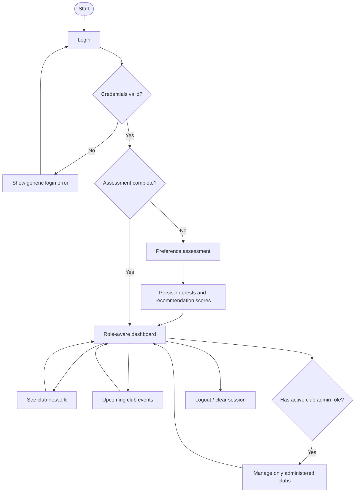
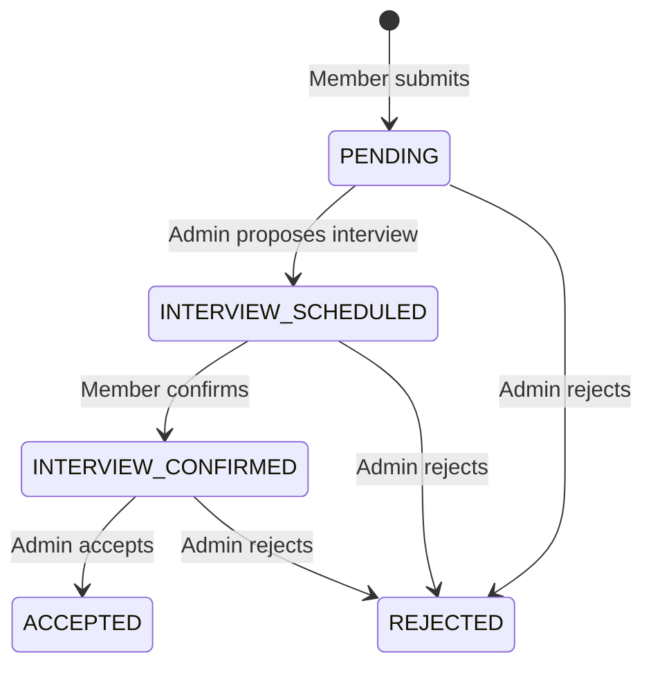
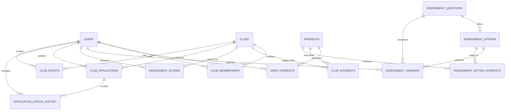

# Kizuna — Project Specification and Codex Build Instructions

> **Project:** Kizuna — Graph-Based Campus Event and Student Club Network System  
> **Primary stack:** Java + JavaFX + Maven + SQLite + SQLite JDBC  
> **Primary rule:** Build a complete, working, small desktop application. Read this entire file before changing code.  
> **Design principle:** **K.I.S.S. — Keep It Simple and Stupid.** Prefer a small, testable implementation over extra frameworks or clever abstractions.

This file is the source of truth for the initial implementation. If the repository already contains useful code, inspect and preserve it. If any conflict exists between existing code and this specification, report the conflict to the main agent and follow this specification unless the user has explicitly changed a requirement.

---

## 1. Mission and definition of success

Build a Java desktop application that helps students discover clubs, complete a preference assessment, apply to clubs, view student/club relationships visually, and browse upcoming club events. Club presidents and vice presidents manage applications, interviews, members, and events only for their own clubs.

This must be a **working application**, not a static UI mock-up. Authentication, recommendations, membership changes, applications, interview scheduling, events, and profile data must be backed by SQLite.

### Non-negotiable principles

1. **Simple architecture:** JavaFX UI → service/business layer → repository/data layer → SQLite.
2. **Data integrity:** use relational constraints, foreign keys, prepared statements, indexes, and transactions where required.
3. **Security:** store salted, slow password hashes—not plaintext passwords; enforce authorization inside service methods, not merely by hiding UI controls.
4. **Honest testing:** do not say a feature or UI flow works unless it was actually tested. Mark blocked checks explicitly.
5. **Clear UI:** readable text, consistent spacing, strong contrast, visible focus, useful empty/error/success states, and no dead buttons.
6. **K.I.S.S.:** do not add Spring, React, a server, an ORM, a graph framework, cloud services, a role-management console, or other features outside the scope below.
7. **Local-app limitation:** this version stores its SQLite database on one computer. It does not synchronize multiple computers or provide a campus-wide network service.

## 2. Required subagent orchestration and concurrency

Use the strongest **Codex subagent / multi-agent workflow available** in this environment. The main Codex agent is the architect, integrator, and final decision-maker. Do not just list agents in a plan: explicitly spawn them, run independent assignments concurrently, wait for their results, and consolidate their findings.

### Phase A — read-only planning (before any code edits)

Launch these four specialist subagents concurrently. They must inspect and report only; no source-file edits during this phase.

1. **System Design & Architecture Agent** — inspect the repository and this specification; validate layers, workflows, package boundaries, and simplicity. Identify any ambiguous requirements before implementation.
2. **Database & ERD Agent** — inspect the ERD and schema below; verify primary/foreign keys, unique/partial indexes, CHECK constraints, query needs, transaction boundaries, seed idempotency, and SQLite limitations.
3. **Security & DSA Agent** — review password hashing, club-scoped authorization, image paths, graph construction, BFS recommendation rules, deterministic ranking, and DSA test cases.
4. **UI/UX Designer Agent + QA Planner** — produce a concise screen/navigation plan, readable JavaFX design checklist, acceptance-test matrix, and end-to-end smoke-test sequence.

Wait for all four results. The main agent must resolve disagreements against this file, settle the contracts, and publish a short implementation plan before the first code edit.

### Phase B — bounded parallel implementation

Use parallel implementation only when tasks are genuinely independent. If the current Codex runtime supports isolated worktrees or separate agent workspaces, prefer them for write-heavy tasks. Otherwise assign exclusive file ownership and never permit two agents to edit the same file concurrently.

Suggested ownership after the common design is approved:

- **Data agent:** `db/`, `model/`, `repository/`, schema/seed logic, and repository tests.
- **Service/DSA agent:** `service/`, password hash helper, authorization tests, graph/BFS logic, application workflow tests. Coordinate public method signatures with the data agent first.
- **UI/UX agent:** `ui/`, CSS/resources, and UI navigation; no SQL and no business rules embedded in screens.
- **QA agent:** test fixtures, tests that do not conflict with other owners, and read-only defect reports.

The main agent owns shared contracts, `pom.xml`, final integration, schema consistency, and the final end-to-end verification. If parallel writing creates conflict risk or the project is too small for useful separation, keep implementation in the main agent and use subagents for independent inspection and review instead. More agents are not automatically better; do not spawn dozens.

### Phase C — independent review in parallel

After implementation and the first successful build, launch at least three read-only reviewers concurrently:

- **Correctness Reviewer:** trace every requirement to the actual implementation and test invalid state transitions.
- **Security & Data Integrity Reviewer:** try cross-club authorization bypasses, invalid foreign keys, duplicate applications, unsafe SQL, insecure password storage, unsafe image paths, and partial transaction failures.
- **UI/UX Accessibility Reviewer:** check font sizes, contrast, keyboard navigation, disabled states, empty/error feedback, small-window clipping, and graph-label legibility.

Ask for concrete findings with severity and file/class references. The main agent must evaluate every finding, fix confirmed defects, and rerun relevant tests. Ignore speculative suggestions that would add complexity without addressing a real requirement. If subagents are not supported, perform separate equivalent review passes and report the limitation honestly; never claim agents were run if they were not.

## 3. Product scope, roles, and permissions

### Roles

A role belongs to a user's membership **within a particular club**, not globally:

- `PRESIDENT`: club administrator.
- `VICE_PRESIDENT`: club administrator.
- `MEMBER`: regular club member.
- A user without an active leadership membership is a regular app user.

A signed-in user may be a member of multiple clubs and may lead one club while browsing or applying to another. Admin navigation must show only the clubs in which that user has an active `PRESIDENT` or `VICE_PRESIDENT` membership.

**Never trust the role or club ID provided by the UI.** Every modifying service call must verify the currently authenticated user and their active leadership membership for the target club. Hiding a button is helpful UI behavior, not a security check.

### Member features

- Sign up, log in, and log out.
- Complete a short preference assessment on first login.
- See the top three eligible club recommendations, with brief reasons.
- See club network as a graph or a selected club as a hierarchy/tree.
- Apply to join a club and see application/interview status.
- Confirm an interview time proposed by a club administrator.
- Browse upcoming events across clubs.
- View and retake the preference assessment.

### Club administrator features

- Log in with a seeded/trusted leadership account.
- View a role-aware dashboard and choose a club they administer.
- See that club's visual network and active member list.
- Review applications for their own club only.
- Propose/reschedule interview date, time, and location.
- Accept or reject eligible applications.
- Remove a regular member from their own club without deleting the user's global account or other club memberships.
- Create, edit, and deactivate/delete events only for their own club(s).

No self-service admin promotion. Regular signup can never set `PRESIDENT` or `VICE_PRESIDENT` in a request or form. Seed six clubs, each with a president and vice-president demo account. Demo credentials must be documented as development-only.

### Explicit non-goals

Do not implement online/cloud synchronization, a web API, chat, emails/SMS, push notifications, attendance tracking, payment, AI/LLM APIs, external calendar integration, advanced graph physics, admin account-promotion UI, or multi-device deployment. Do not create extra systems unrelated to the brief.

## 4. System design and architecture

### 4.1 Architecture diagram

Use this as the required dependency direction. Keep the design as a small layered monolith in one Java desktop process.



Rules for the dependency direction:

- `ui/` calls service methods and renders returned models/view data. **No SQL in JavaFX screen code.**
- `service/` owns validation, status transitions, role checks, recommendation ranking, and transaction boundaries.
- `repository/` owns prepared SQL, row-to-model mapping, and simple queries. It does not decide UI behavior.
- `db/` owns connection creation, schema versioning, schema setup, and idempotent seed data.
- `model/` contains small domain models/records and enums.
- `util/` contains password hashing, photo storage/validation, and date/time formatting.
- SQLite constraints defend stored data; service rules defend meaningful cross-row/workflow behavior.
- Keep repositories small. Multi-step transactional service operations must use the **same JDBC connection** from start to commit/rollback; repositories must not silently open separate connections inside that transaction.

### 4.2 Core user flow



### 4.3 Main workflows and transaction boundaries

| Operation | Required steps | Atomic transaction? |
|---|---|---|
| Signup | Validate input → hash password → insert user | Yes for the user insert; never partially create an account |
| Retake assessment | Save current answers → rebuild `user_interests` → run BFS/scoring → replace `assessment_scores` → mark completed | **Yes**, all derived data must correspond to the same latest answers |
| Submit application | Validate membership/duplicate state → insert application → insert history entry | **Yes** |
| Schedule/reschedule interview | Verify club admin → validate future date/time/location → update application fields/status as appropriate → insert history row | **Yes** |
| Confirm interview | Verify applicant owns the application and status is `INTERVIEW_SCHEDULED` → set confirmation time and status → insert history | **Yes** |
| Reject application | Verify admin scope and legal status → set `REJECTED`, reviewer and time → insert history | **Yes** |
| Accept application | Verify admin scope and `INTERVIEW_CONFIRMED` status → set `ACCEPTED` → insert/reactivate `MEMBER` membership → insert history | **Yes**; rollback all if any step fails |
| Remove member | Verify admin scope and target role is `MEMBER` → mark only that club membership inactive | Yes |
| Save event | Verify club admin → validate fields/times → insert/update/deactivate one club event | Yes for the write |

### 4.4 Application state machine

The allowed workflow is:



An admin can reschedule while status is `INTERVIEW_SCHEDULED`; record the reschedule in history. Rejecting a pending application is allowed. An application can never jump directly from `PENDING` to `ACCEPTED`, from `PENDING` to `INTERVIEW_CONFIRMED`, or from a terminal `ACCEPTED`/`REJECTED` state to another state. This is enforced in the service and guarded by a small SQLite trigger.

## 5. Required data structures and algorithms (DSA)

Implement the four concepts below explicitly and document where each is used. Do not add an external graph library or a sophisticated recommendation engine.

### 5.1 Password hashing for authentication

The requested “Hashing” concept means **cryptographic password hashing**, not simply putting a password in a Java `HashMap` or applying a fast SHA hash.

- Use JDK `PBKDF2WithHmacSHA256`, a unique cryptographically random 16-byte salt per account, a 32-byte derived key, and **600,000 iterations** as the default work factor.
- Encode a self-describing stored value such as `pbkdf2_sha256$600000$<salt-base64>$<derived-key-base64>` in `users.password_hash`.
- Use `SecureRandom`; use `PBEKeySpec`; always clear password chars from `PBEKeySpec` in a `finally` block; compare derived bytes using `MessageDigest.isEqual`.
- Never save plaintext passwords, even for demo accounts. Never print credentials or hashes to logs.
- Do not use MD5, SHA-1, plain SHA-256, reversible encryption, or homemade algorithms for passwords.
- Benchmark on the target machine if login feels slow. Any lower iteration count needs a written reason; don't silently lower it.
- Hash/verify on a JavaFX `Task` or equivalent background worker so PBKDF2 does not freeze the UI. Disable the submit button while a request is running and restore it on success/failure.
- Return one generic message for invalid username/password. Do not reveal whether a username exists.
- This local desktop prototype still cannot provide the protections of a properly deployed server. Treat demo accounts as development-only.

### 5.2 Graph representation

Use an adjacency-list representation in Java—e.g. `Map<NodeKey, List<GraphEdge>>`—because it is straightforward and efficient for this small app. A small `GraphNodeType`/`GraphEdgeType` enum is sufficient. Avoid a general graph framework.

There are two related graph views built from normalized SQLite records:

**A. Club membership graph (visual network)**

- Club nodes represent clubs.
- Student nodes represent users.
- An edge exists only if `club_memberships.status = 'ACTIVE'` for that club and user.
- President/vice-president role is metadata on the membership edge or member node for the selected club.
- Do not display inactive memberships or pending applicants as club members.

**B. Recommendation graph (for BFS)**

- Student node → interest node for each row in `user_interests` with a positive score.
- Interest node → club node for each matching row in `club_interests`.
- Store `club_interests` in its normalized direction (club-to-interest relation) but construct the reverse `Interest → Club` adjacency for recommendation traversal.
- Do **not** traverse membership edges during recommendation BFS. That prevents recommendations from spreading through other students' memberships instead of the current student's interests.

### 5.3 Breadth-First Search (BFS) recommendation algorithm

BFS must be actual executable Java code and have automated tests. Do not merely write “uses BFS” in comments while using unrelated SQL ranking alone.

1. Read the current student's selected answers and rebuild that student's `user_interests` from the configured option-to-interest mappings.
2. Build the directed recommendation adjacency: `Student → Interest → Club`.
3. Run BFS from the current student node using `ArrayDeque` as a queue and `HashSet` for visited node IDs. The traversal is limited to the two semantic hops: student → interest → club.
4. Record the clubs reached and the interests that connect the student to each club.
5. Compute a transparent match score for each club: sum the student's positive interest weights for interests shared by that club. BFS discovers valid matches; this simple score orders the discovered candidates.
6. Include every active club in the saved score set; a club not reached by BFS receives score `0` so the UI has a predictable fallback rather than failing when there are few/no matches.
7. Exclude clubs where the user already has an active membership or an active application (`PENDING`, `INTERVIEW_SCHEDULED`, `INTERVIEW_CONFIRMED`) from the **eligible recommendations**. Do not delete their scores merely because they are excluded from the list.
8. Sort eligible clubs by score descending, then club name ascending using a case-insensitive comparison. This tie-break makes results reproducible. Show the top three eligible clubs, or fewer if fewer eligible clubs remain.
9. Each recommendation needs a short truthful reason based on shared interest tags. For a zero-score fallback, say that the match score is zero and invite the user to review the club description; do not invent an interest match.
10. Persist answers, interests, assessment completion time, and all club scores in one transaction. Re-running or retaking the assessment must replace the current answer/derived-score set, not create duplicates.

BFS complexity should be linear in the visited graph portion (`O(V + E)`). Do not add weighted shortest-path algorithms, ML, or network-wide social inference.

### 5.4 Tree / hierarchy visualization

Provide a switch or tab in **See Club Network** for **Network Graph** and **Club Hierarchy**. Both views must use the same authoritative active membership data.

- **Network Graph:** show club and student nodes connected by active membership edges, with a club filter. A selected-club filter should focus on the chosen club and its active members.
- **Club Hierarchy:** show the selected club as the root node; the next level groups `President`, `Vice President`, and `Members`; student nodes appear as leaves under the correct group. Empty groups can display “No active members”.
- Each student node/card shows profile photo or initials placeholder, full display name, current academic year, and (for that selected club) membership role where useful. Do not display the user's student ID number, password, phone, email, or application answers.
- Use JavaFX `Pane`, `Line`, `VBox`/`HBox`, a `ScrollPane`, and simple deterministic positions. If labels become cramped, increase content size and allow scrolling rather than shrinking text.
- Do not add force-directed simulation, drag-to-rearrange persistence, zoom engines, or external graph packages. The graph must remain understandable and testable.

## 6. Database system design

### 6.1 Database location and connection policy

Use a per-user application data directory, such as:

`Path.of(System.getProperty("user.home"), ".kizuna")`

Store:

- SQLite file: `.kizuna/kizuna.db`
- Copied profile images: `.kizuna/avatars/`

Create directories if absent. Do not store the working database in the source repository or rely on the current working directory. Document this path, backup guidance, and a safe way to reset development data in `README.md`.

- Open a JDBC connection for a repository operation or transaction; do not share one mutable `Connection` among unrelated JavaFX tasks.
- Execute `PRAGMA foreign_keys = ON` on **every new connection** and verify it is enabled in tests.
- Set a reasonable `PRAGMA busy_timeout` (e.g. `5000`) per connection.
- Enable foreign keys before beginning a transaction.
- Keep SQL values in `PreparedStatement` parameters. Never concatenate user-controlled input into SQL.
- Use `try-with-resources` for `Connection`, `PreparedStatement`, and `ResultSet`.
- Use one transaction connection for each multi-step transaction. On error, roll back and return a helpful error state; never leave partial derived data.
- Use integer epoch milliseconds (`*_at_ms`) for timestamps in storage. Convert from/to Java `Instant` and the local system time zone at UI/service boundaries. This makes comparison and chronological ordering consistent.
- Use `PRAGMA user_version` for a small schema version. Implement a clear first migration and refuse to open a database with a newer unknown schema version. Do not add a separate migration framework.

### 6.2 Required entity relationship diagram (ERD)

The ERD below is required guidance. Keep table/column names consistent with it and the schema in Section 7. Do not create duplicate sources of truth for roles, memberships, or interests.



### 6.3 Data integrity rules

Use the database to enforce rules that fit relational constraints and the service layer to enforce authorization and workflows. Do not rely on the UI alone.

- Every row uses a primary key; all required fields are `NOT NULL`.
- Add foreign keys for every relationship shown in the ERD.
- Add `CHECK` constraints for role/status vocabularies, boolean fields, positive weights, and date/time ordering.
- Use `UNIQUE` constraints for usernames, club names, interest codes, user/club membership pairs, question keys, option keys per question, and related mapping pairs.
- Use a **partial unique index** to prevent more than one active application by the same user to the same club while still preserving old rejected/accepted records.
- Use partial unique indexes so a club has at most one active president and at most one active vice president.
- Enforce legal application status transitions in service logic and with the transition trigger in Section 7.
- Accepting an application must change application status, add/reactivate membership, and add history in a single transaction.
- Removing a member must mark only the `(user_id, club_id)` membership inactive. Never delete the global user or their memberships to other clubs.
- Events are soft-deactivated (`is_active = 0`) rather than physically deleted; public views show only active upcoming events. This keeps event history simple and prevents accidental loss.
- Retaking an assessment must transactionally replace answers, derived interests, and calculated scores together.
- `photo_filename` stores a generated filename only, never an absolute path supplied by the user. Resolve images under the application-owned avatars folder and reject path traversal.
- Club admins can only modify their own club's data. Service authorization must require an active leadership membership for the target club. Database foreign keys can prove that an actor has a membership row, but the service must additionally check the active status and leadership role.
- Do not physically delete clubs or users during normal workflows. Seeded clubs remain stable and have unique names/codes.

## 7. Database tables and reference schema

Implement the tables and constraints below. Use `CREATE TABLE IF NOT EXISTS` as appropriate and create all indexes/triggers idempotently. If the repository already contains a database schema, inspect it and add a clean migration rather than dropping user data without permission.

### 7.1 Table dictionary

| Table | Purpose | Primary/unique keys | Critical relationships/rules |
|---|---|---|---|
| `users` | Accounts and student profile | `id`; case-insensitive unique `username` | Stores `password_hash`; stores generated `photo_filename`, not arbitrary paths; `assessment_completed_at_ms` is null until first completed assessment |
| `clubs` | Club directory | `id`; unique name | Seed the six starter clubs exactly once |
| `interests` | Canonical interest tags | `id`; unique `code` and `name` | Shared vocabulary for students, clubs, and assessment choices |
| `club_memberships` | User roles and membership state per club | `id`; unique `(user_id, club_id)` | Role is per club; status is active/inactive; one active president and vice president per club |
| `user_interests` | Current derived interest profile | composite `(user_id, interest_id)` | Rebuilt from the student's latest assessment; score is positive summed weight |
| `club_interests` | Interest tags for each club | composite `(club_id, interest_id)` | Drives BFS recommendations and match reasons |
| `assessment_questions` | Seeded assessment question catalogue | `id`; unique `question_key` | Fixed app-defined catalogue; no question-editor UI in this version |
| `assessment_options` | Answer options per question | `id`; unique `(question_id, option_key)` | Composite uniqueness allows an answer to verify its option belongs to the selected question |
| `assessment_option_interests` | Maps selected answers to interests and weights | composite `(option_id, interest_id)` | Weight is a small integer; used to derive `user_interests` |
| `assessment_answers` | Latest submitted answer for each question/user | composite `(user_id, question_id)` | Option must belong to the referenced question; retaking replaces the current answer set |
| `assessment_scores` | Persisted per-user/per-club recommendation score | composite `(user_id, club_id)` | Score derived from shared interest weights; rank/sort computed deterministically in service/UI |
| `club_applications` | Application and interview lifecycle | `id` | One active application per user/club; includes schedule, confirmation, and reviewer metadata |
| `application_status_history` | Application status/audit trail | `id` | Records each status change, scheduling/rescheduling, confirming, acceptance, and rejection |
| `club_events` | Club event listing and management | `id` | Event has a club and creator; end must be after start; soft-delete through `is_active` |

### 7.2 Schema SQL (required baseline)

The agent may adjust small details if a test demonstrates a real SQLite compatibility issue, but must preserve the constraints and relationships. Keep schema creation in one clearly named schema/migration file or class, not scattered across screens.

```sql
CREATE TABLE IF NOT EXISTS users (
    id INTEGER PRIMARY KEY,
    username TEXT NOT NULL COLLATE NOCASE UNIQUE
        CHECK (length(trim(username)) BETWEEN 3 AND 32),
    password_hash TEXT NOT NULL CHECK (length(password_hash) > 20),
    full_name TEXT NOT NULL CHECK (length(trim(full_name)) BETWEEN 1 AND 80),
    academic_year TEXT NOT NULL CHECK (
        academic_year IN ('1st Year','2nd Year','3rd Year','4th Year','5th Year','Other')
    ),
    photo_filename TEXT,
    created_at_ms INTEGER NOT NULL,
    assessment_completed_at_ms INTEGER,
    is_active INTEGER NOT NULL DEFAULT 1 CHECK (is_active IN (0,1))
);

CREATE TABLE IF NOT EXISTS clubs (
    id INTEGER PRIMARY KEY,
    name TEXT NOT NULL COLLATE NOCASE UNIQUE
        CHECK (length(trim(name)) BETWEEN 1 AND 80),
    description TEXT NOT NULL CHECK (length(trim(description)) BETWEEN 1 AND 1000)
);

CREATE TABLE IF NOT EXISTS interests (
    id INTEGER PRIMARY KEY,
    code TEXT NOT NULL COLLATE NOCASE UNIQUE,
    name TEXT NOT NULL COLLATE NOCASE UNIQUE
);

CREATE TABLE IF NOT EXISTS club_memberships (
    id INTEGER PRIMARY KEY,
    user_id INTEGER NOT NULL,
    club_id INTEGER NOT NULL,
    role TEXT NOT NULL CHECK (role IN ('MEMBER','PRESIDENT','VICE_PRESIDENT')),
    status TEXT NOT NULL DEFAULT 'ACTIVE' CHECK (status IN ('ACTIVE','INACTIVE')),
    joined_at_ms INTEGER NOT NULL,
    updated_at_ms INTEGER NOT NULL,
    UNIQUE (user_id, club_id),
    FOREIGN KEY (user_id) REFERENCES users(id) ON DELETE RESTRICT,
    FOREIGN KEY (club_id) REFERENCES clubs(id) ON DELETE RESTRICT
);

CREATE UNIQUE INDEX IF NOT EXISTS ux_one_active_president_per_club
    ON club_memberships(club_id)
    WHERE role = 'PRESIDENT' AND status = 'ACTIVE';

CREATE UNIQUE INDEX IF NOT EXISTS ux_one_active_vice_president_per_club
    ON club_memberships(club_id)
    WHERE role = 'VICE_PRESIDENT' AND status = 'ACTIVE';

CREATE INDEX IF NOT EXISTS ix_memberships_club_status
    ON club_memberships(club_id, status, role);

CREATE TABLE IF NOT EXISTS user_interests (
    user_id INTEGER NOT NULL,
    interest_id INTEGER NOT NULL,
    score INTEGER NOT NULL CHECK (score > 0),
    updated_at_ms INTEGER NOT NULL,
    PRIMARY KEY (user_id, interest_id),
    FOREIGN KEY (user_id) REFERENCES users(id) ON DELETE CASCADE,
    FOREIGN KEY (interest_id) REFERENCES interests(id) ON DELETE RESTRICT
);

CREATE INDEX IF NOT EXISTS ix_user_interests_interest
    ON user_interests(interest_id, user_id);

CREATE TABLE IF NOT EXISTS club_interests (
    club_id INTEGER NOT NULL,
    interest_id INTEGER NOT NULL,
    PRIMARY KEY (club_id, interest_id),
    FOREIGN KEY (club_id) REFERENCES clubs(id) ON DELETE RESTRICT,
    FOREIGN KEY (interest_id) REFERENCES interests(id) ON DELETE RESTRICT
);

CREATE INDEX IF NOT EXISTS ix_club_interests_interest
    ON club_interests(interest_id, club_id);

CREATE TABLE IF NOT EXISTS assessment_questions (
    id INTEGER PRIMARY KEY,
    question_key TEXT NOT NULL COLLATE NOCASE UNIQUE,
    prompt TEXT NOT NULL CHECK (length(trim(prompt)) BETWEEN 1 AND 500),
    sort_order INTEGER NOT NULL UNIQUE CHECK (sort_order > 0),
    is_active INTEGER NOT NULL DEFAULT 1 CHECK (is_active IN (0,1))
);

CREATE TABLE IF NOT EXISTS assessment_options (
    id INTEGER PRIMARY KEY,
    question_id INTEGER NOT NULL,
    option_key TEXT NOT NULL COLLATE NOCASE,
    label TEXT NOT NULL CHECK (length(trim(label)) BETWEEN 1 AND 300),
    UNIQUE (question_id, option_key),
    UNIQUE (id, question_id),
    FOREIGN KEY (question_id) REFERENCES assessment_questions(id) ON DELETE RESTRICT
);

CREATE TABLE IF NOT EXISTS assessment_option_interests (
    option_id INTEGER NOT NULL,
    interest_id INTEGER NOT NULL,
    weight INTEGER NOT NULL DEFAULT 1 CHECK (weight BETWEEN 1 AND 3),
    PRIMARY KEY (option_id, interest_id),
    FOREIGN KEY (option_id) REFERENCES assessment_options(id) ON DELETE RESTRICT,
    FOREIGN KEY (interest_id) REFERENCES interests(id) ON DELETE RESTRICT
);

CREATE TABLE IF NOT EXISTS assessment_answers (
    user_id INTEGER NOT NULL,
    question_id INTEGER NOT NULL,
    option_id INTEGER NOT NULL,
    answered_at_ms INTEGER NOT NULL,
    PRIMARY KEY (user_id, question_id),
    FOREIGN KEY (user_id) REFERENCES users(id) ON DELETE CASCADE,
    FOREIGN KEY (question_id) REFERENCES assessment_questions(id) ON DELETE RESTRICT,
    FOREIGN KEY (option_id, question_id)
        REFERENCES assessment_options(id, question_id) ON DELETE RESTRICT
);

CREATE TABLE IF NOT EXISTS assessment_scores (
    user_id INTEGER NOT NULL,
    club_id INTEGER NOT NULL,
    score INTEGER NOT NULL CHECK (score >= 0),
    calculated_at_ms INTEGER NOT NULL,
    PRIMARY KEY (user_id, club_id),
    FOREIGN KEY (user_id) REFERENCES users(id) ON DELETE CASCADE,
    FOREIGN KEY (club_id) REFERENCES clubs(id) ON DELETE RESTRICT
);

CREATE INDEX IF NOT EXISTS ix_assessment_scores_user_score
    ON assessment_scores(user_id, score DESC, club_id);

CREATE TABLE IF NOT EXISTS club_applications (
    id INTEGER PRIMARY KEY,
    applicant_id INTEGER NOT NULL,
    club_id INTEGER NOT NULL,
    motivation TEXT NOT NULL CHECK (length(trim(motivation)) BETWEEN 1 AND 500),
    experience TEXT CHECK (experience IS NULL OR length(experience) <= 300),
    availability_notes TEXT CHECK (availability_notes IS NULL OR length(availability_notes) <= 300),
    status TEXT NOT NULL DEFAULT 'PENDING' CHECK (
        status IN ('PENDING','INTERVIEW_SCHEDULED','INTERVIEW_CONFIRMED','ACCEPTED','REJECTED')
    ),
    submitted_at_ms INTEGER NOT NULL,
    updated_at_ms INTEGER NOT NULL,
    interview_at_ms INTEGER,
    interview_location TEXT CHECK (interview_location IS NULL OR length(trim(interview_location)) <= 200),
    interview_scheduled_by INTEGER,
    interview_confirmed_at_ms INTEGER,
    reviewed_by INTEGER,
    reviewed_at_ms INTEGER,
    FOREIGN KEY (applicant_id) REFERENCES users(id) ON DELETE RESTRICT,
    FOREIGN KEY (club_id) REFERENCES clubs(id) ON DELETE RESTRICT,
    FOREIGN KEY (interview_scheduled_by, club_id)
        REFERENCES club_memberships(user_id, club_id) ON DELETE RESTRICT,
    FOREIGN KEY (reviewed_by, club_id)
        REFERENCES club_memberships(user_id, club_id) ON DELETE RESTRICT,
    CHECK (
        status NOT IN ('INTERVIEW_SCHEDULED','INTERVIEW_CONFIRMED','ACCEPTED')
        OR (interview_at_ms IS NOT NULL AND interview_location IS NOT NULL
            AND length(trim(interview_location)) > 0 AND interview_scheduled_by IS NOT NULL)
    ),
    CHECK (
        status NOT IN ('INTERVIEW_CONFIRMED','ACCEPTED')
        OR interview_confirmed_at_ms IS NOT NULL
    ),
    CHECK (
        status NOT IN ('ACCEPTED','REJECTED')
        OR (reviewed_by IS NOT NULL AND reviewed_at_ms IS NOT NULL)
    )
);

CREATE UNIQUE INDEX IF NOT EXISTS ux_one_active_application_per_user_club
    ON club_applications(applicant_id, club_id)
    WHERE status IN ('PENDING','INTERVIEW_SCHEDULED','INTERVIEW_CONFIRMED');

CREATE INDEX IF NOT EXISTS ix_applications_club_status_submitted
    ON club_applications(club_id, status, submitted_at_ms);

CREATE INDEX IF NOT EXISTS ix_applications_applicant_status
    ON club_applications(applicant_id, status);

CREATE TABLE IF NOT EXISTS application_status_history (
    id INTEGER PRIMARY KEY,
    application_id INTEGER NOT NULL,
    previous_status TEXT CHECK (
        previous_status IS NULL OR previous_status IN (
            'PENDING','INTERVIEW_SCHEDULED','INTERVIEW_CONFIRMED','ACCEPTED','REJECTED'
        )
    ),
    new_status TEXT NOT NULL CHECK (
        new_status IN ('PENDING','INTERVIEW_SCHEDULED','INTERVIEW_CONFIRMED','ACCEPTED','REJECTED')
    ),
    changed_by INTEGER NOT NULL,
    note TEXT CHECK (note IS NULL OR length(note) <= 300),
    changed_at_ms INTEGER NOT NULL,
    FOREIGN KEY (application_id) REFERENCES club_applications(id) ON DELETE CASCADE,
    FOREIGN KEY (changed_by) REFERENCES users(id) ON DELETE RESTRICT
);

CREATE INDEX IF NOT EXISTS ix_application_history_app_time
    ON application_status_history(application_id, changed_at_ms);

CREATE TABLE IF NOT EXISTS club_events (
    id INTEGER PRIMARY KEY,
    club_id INTEGER NOT NULL,
    created_by INTEGER NOT NULL,
    title TEXT NOT NULL CHECK (length(trim(title)) BETWEEN 1 AND 120),
    description TEXT NOT NULL CHECK (length(trim(description)) BETWEEN 1 AND 2000),
    location TEXT NOT NULL CHECK (length(trim(location)) BETWEEN 1 AND 200),
    starts_at_ms INTEGER NOT NULL,
    ends_at_ms INTEGER NOT NULL,
    created_at_ms INTEGER NOT NULL,
    updated_at_ms INTEGER NOT NULL,
    is_active INTEGER NOT NULL DEFAULT 1 CHECK (is_active IN (0,1)),
    CHECK (ends_at_ms > starts_at_ms),
    FOREIGN KEY (club_id) REFERENCES clubs(id) ON DELETE RESTRICT,
    FOREIGN KEY (created_by, club_id)
        REFERENCES club_memberships(user_id, club_id) ON DELETE RESTRICT
);

CREATE INDEX IF NOT EXISTS ix_events_active_start
    ON club_events(is_active, starts_at_ms, club_id);
```

Add this trigger after the tables exist:

```sql
CREATE TRIGGER IF NOT EXISTS trg_valid_application_status_transition
BEFORE UPDATE OF status ON club_applications
FOR EACH ROW
WHEN OLD.status <> NEW.status
 AND NOT (
      (OLD.status = 'PENDING' AND NEW.status IN ('INTERVIEW_SCHEDULED','REJECTED'))
   OR (OLD.status = 'INTERVIEW_SCHEDULED' AND NEW.status IN ('INTERVIEW_CONFIRMED','REJECTED'))
   OR (OLD.status = 'INTERVIEW_CONFIRMED' AND NEW.status IN ('ACCEPTED','REJECTED'))
 )
BEGIN
    SELECT RAISE(ABORT, 'Invalid club application status transition');
END;
```

**Important implementation notes for this schema:**

- `foreign_keys` must be enabled on every connection or these relationships are not enforced by SQLite.
- The composite FKs for `interview_scheduled_by`, `reviewed_by`, and event `created_by` prove the actor has a membership row for the same club. The service must still verify that the membership is active and has a leadership role.
- `CHECK` constraints validate values/relationships within a row; they do not replace service validation for permissions, active membership, dates relative to “now”, or valid business workflow.
- The trigger protects state transitions at the database level. The service must still apply the same allowed-transition table and create history entries in the same transaction.
- A rejected application can be resubmitted later because `REJECTED` is not covered by the partial unique active-application index. An accepted applicant is not eligible to apply again while their membership is active.
- The schema is a baseline, not permission to drop an existing database. Migrate data safely if an earlier schema exists.

### 7.3 Starter clubs and suggested interest tags

Seed the following clubs once using unique keys and idempotent inserts. Never add duplicates at each launch.

| Club | Description | Starter interest tags |
|---|---|---|
| Kaminari | Japanese musical and dance art. | `JAPANESE_CULTURE`, `MUSIC`, `DANCE`, `PERFORMANCE`, `ART` |
| Peer | Peer networking and support through fellow club members. | `PEER_SUPPORT`, `COMMUNICATION`, `NETWORKING`, `MENTORSHIP`, `COMMUNITY` |
| Ichiban | Music, dance, and art across different themes. | `MUSIC`, `DANCE`, `ART`, `CREATIVITY`, `PERFORMANCE` |
| Tsuushin | Journalism and student reporting. | `WRITING`, `JOURNALISM`, `MEDIA`, `COMMUNICATION`, `PHOTOGRAPHY` |
| Kendo | Kendo-focused practice and activities. | `MARTIAL_ARTS`, `DISCIPLINE`, `FITNESS`, `TRADITION`, `TEAMWORK` |
| Red Cross | First aid and helping people prepare for emergencies. | `FIRST_AID`, `VOLUNTEERING`, `PUBLIC_SERVICE`, `EMERGENCY_PREPAREDNESS`, `COMMUNITY` |

Use the `interests`, `club_interests`, assessment question/option tables and `assessment_option_interests` mappings to keep the matching vocabulary consistent. Seed no more than five short multiple-choice questions. Each option should map to one or more interest tags with a weight of 1–3. All six clubs must be reachable by meaningful answer combinations or receive a deterministic zero-score fallback.

### 7.4 Seed accounts and sample data

- Include fictional members, a few events, and application examples so the graph and workflows can be demonstrated immediately.
- Seed one president and one vice president for each club (12 leadership accounts in total) if practical for the demo flow. Use generated salted PBKDF2 hashes, not plaintext stored in the database.
- Only create a demo account if it does not already exist. Re-running seed logic must not reset a user's password, recreate duplicate memberships, or overwrite user edits.
- Use generated initials/placeholder avatars. Do not use real student ID cards or real students' photos.
- Document any demo credentials in `README.md` and prominently label them **LOCAL DEVELOPMENT ONLY**. Do not use them for real student records.
- If the environment supports a first-run demo/bootstrap setup more safely than automatic seeding, preserve simplicity but ensure the complete sample flow is demonstrable.

## 8. Authentication, profile images, time, and safety

### 8.1 Authentication/session

- Signup creates only a regular user. No submitted form field can set an admin role.
- Normalize/trim usernames consistently and rely on a database unique constraint to handle race conditions.
- Require sensible password length; allow passphrases and do not silently trim/alter passwords.
- On logout, clear the authenticated user/session and any role-specific in-memory state; return to Login.
- Use the active account flag to reject login for disabled accounts.
- Never log password inputs, stored password hashes, or full private application answers.

### 8.2 Profile photos

- Optional signup photo formats: JPG/JPEG and PNG; maximum file size 5 MB.
- Validate that the file is decodable as an image, not only that the extension matches.
- Copy it to `.kizuna/avatars/` under a generated UUID-based file name. Store only that generated file name in `users.photo_filename`.
- On read, resolve the filename under the owned avatars directory and ensure it cannot escape that directory. If missing or invalid, show the standard initials placeholder.
- The profile photo is display content, not a student ID number. Keep phone, email, and other private profile data out of the public network graph.

### 8.3 Dates and validation

- Store timestamps as epoch milliseconds. Convert JavaFX date/time controls using `LocalDateTime`, the configured desktop zone (e.g. `ZoneId.systemDefault()`), and `Instant`.
- Reject a new interview date/time in the past. Reject a new event whose start is in the past. Event end must be after event start.
- Validate text limits in the service layer in addition to JavaFX feedback. Do not rely on database `CHECK` constraints alone for friendly validation.
- Use clear messages close to the action that failed. Never display raw SQL exceptions or stack traces to the user.

## 9. Required UI/UX design instructions

Design the app to feel calm, modern, consistent, and appropriate for a college information system. Keep the visual design polished without clutter or decorative excess.

### 9.1 Visual system

Use a single CSS file, `src/main/resources/css/app.css`, with reusable style classes. Suggested palette:

| Purpose | Value |
|---|---|
| App background | `#F6F8FA` |
| Navigation / primary | `#17324D` |
| Accent / action | `#2B817A` |
| Surface / card | `#FFFFFF` |
| Main text | `#1F2937` |
| Secondary text | `#586576` |
| Border | `#D8E0E8` |
| Error | `#B42318` |
| Success | `#16794B` |
| Warning | `#8A5A00` |

- Use system fonts only; do not download font files.
- General body and form-control text should be **14 pt or larger** where practical. Buttons should be around **15 pt**, and major headings about **22–28 pt**. Avoid tiny status labels.
- Buttons should have clear text, high contrast, visible hover/focus/disabled states, and a minimum height around 40–44 px.
- Use consistent spacing steps (for example 8, 12, 16, 24, 32 px) and align form labels/controls.
- Make layouts resize cleanly. Default stage can be around 1100×720 with a minimum around 900×600; use `ScrollPane` rather than squeezing or clipping content.
- Use moderate rounded corners and subtle borders. Avoid oversized shadows, constant animation, excessive gradients, emoji as the sole iconography, and crowded dashboards.
- Never rely on color alone to distinguish application statuses: pair badges/colors with readable status text.

### 9.2 Navigation and screens

- Use a consistent header/navigation pattern: Kizuna title, current account identity, page title/breadcrumb if useful, and a visible Logout button.
- Member dashboard: two clear primary cards/buttons—**See Club Network** and **Upcoming Club Events**—plus a small assessment/recommendations entry.
- Admin dashboard: the same discovery options plus **Manage My Clubs**. Show only clubs that the signed-in user administers.
- Avoid opening a new window for every action. Prefer a main content area with clear Back/Cancel navigation and modest dialogs for confirmations.
- Login: labelled username/password fields, one primary Login button, clear Sign Up action, and a generic error message.
- Signup: labelled fields, password confirmation, year dropdown, optional photo picker with preview/placeholder, inline validation, and a clear submit/cancel action.
- Assessment: one question per card or one uncluttered form; clear progress, radio choices with readable hit targets, Back/Submit/Retake where appropriate, and a clear results page.
- Club network: visible toggle/tab for Network Graph and Club Hierarchy; club selector; readable node labels; placeholder avatars; legend explaining club/student/role nodes.
- Applications: table/list showing club, applicant name, submitted date, status, and next action. Only admins of that club may inspect full application responses.
- Interview workflow: clearly show proposed date, time, and location; distinguish “awaiting member confirmation” from “confirmed”. Disable actions that are invalid in the current status and give a short explanation.
- Events: cards or a clean list sorted by start time; show event title, club, start/end, location, and short description. Event details must remain readable. Admin forms need explicit date/time controls and validation.

### 9.3 Interaction and accessibility

- Every visible button must work, or be disabled with a visible reason. No placeholder buttons and no silently swallowed errors.
- Put persistent labels above or beside controls; placeholder text is not a label.
- Provide a visible keyboard focus indicator and logical tab order. Keyboard-only navigation must reach all core actions.
- Buttons and list rows must have understandable accessible text. Give profile photos appropriate alternative text where supported.
- Disable submit buttons during async work and prevent double-submission. Show success/failure messages in the view where the action occurred.
- Confirm destructive actions such as member removal and event deactivation. Allow users to cancel without changes.
- Provide useful empty states, including no upcoming events, no active club members, no matching recommendations, no applications, and no search/filter results.
- Keep table columns from overflowing; allow horizontal/vertical scrolling where necessary.
- For password hashing or another slow operation, use a JavaFX `Task`/equivalent and update controls only on the JavaFX Application Thread.
- Check the UI at default and smaller window sizes. Record any GUI tests that cannot be performed because Codex has no display access.

## 10. Recommended project structure and toolchain

Use a non-modular, single Maven project unless the existing repository has a working modular setup. Prefer Java-created layouts over FXML for the initial small app unless the repository already uses FXML successfully.

```text
AGENTS.md
README.md
pom.xml
src/
  main/
    java/com/kizuna/
      KizunaApp.java
      db/             # connection factory, schema/migrations, seed data
      model/          # domain records/classes and enums
      repository/     # prepared SQL and row mapping
      service/        # auth, authorization, assessment/BFS, applications, members, events
      ui/             # login, signup, dashboard, network/tree, applications, events
      util/           # password hashing, avatar storage, validation, time conversion
    resources/
      css/app.css
  test/
    java/com/kizuna/ # JUnit tests using isolated temporary SQLite databases
```

### Compatibility and dependencies

- Preferred baseline: **JDK 25 + JavaFX 27** with Maven. OpenJFX documents JavaFX 27 as requiring JDK 25 or later.
- Inspect the JDK already installed in the user's environment before selecting dependency versions. If JDK 25 cannot reasonably be used but a supported JDK 21 LTS is already installed, use a compatible JavaFX 21 pairing rather than mixing incompatible versions; document the choice.
- Use `javafx-controls`, the OpenJFX Maven plugin, `org.xerial:sqlite-jdbc`, and JUnit Jupiter. Keep versions in Maven properties when practical and choose current stable versions from official documentation.
- Do not add an ORM, Spring, React, dependency injection, a graph library, or an authentication library.
- Add `module-info.java` only if required by the existing project/toolchain. Non-modular Maven JavaFX is acceptable.
- Do not introduce background thread pools unless the app demonstrates a need. Use a small `Task` for known slow work such as password derivation.

## 11. Implementation order and loop engineering

Build a complete vertical slice at a time and keep the application runnable. Do not create every screen as a mock-up and postpone persistence until the end.

### Implementation order

1. Inspect repository, JDK/Maven versions, existing classes, and build commands. Preserve useful work.
2. Approve the architecture, ERD, schema, state machine, service/repository method contracts, and UI navigation after parallel planning agents report back.
3. Set up Maven/JavaFX startup, CSS, app-data paths, SQLite connection factory, `PRAGMA foreign_keys`, schema migration, constraints, and seed data.
4. Implement password hashing, signup, login/logout, active session, trusted seeded admin roles, and role-aware dashboard.
5. Implement seeded interest/assessment catalogue, answer persistence, user-interest derivation, BFS, deterministic scores, and recommendation UI.
6. Implement membership repositories/services, club membership graph, and club hierarchy visualization.
7. Implement applications, history log, interview scheduling/confirmation, transitions, and acceptance transaction.
8. Implement club-specific member list/removal and authorization checks.
9. Implement upcoming event list and club-scoped create/edit/deactivate flows.
10. Improve inline validation, empty/error/success states, accessible focus, keyboard behavior, photo fallback, layout resizing, and CSS consistency.
11. Run database/security/DSA tests, full Maven tests, build, and GUI smoke test where possible.
12. Run parallel independent reviews, fix confirmed findings, and rerun relevant tests.

### Required engineering loop

Use this explicit feedback loop throughout implementation:

**Inspect → Plan → Implement → Compile → Test → Review → Fix → Retest**

After each significant vertical slice:

- Compile and run unit/integration tests.
- Inspect actual failures and correct root causes, not just symptoms.
- Review relevant acceptance criteria.
- Have a separate reviewer or subagent examine the highest-risk changes.
- Repeat until tests pass or a genuine blocker is documented.

Run up to four fix/review cycles for a confirmed issue set; if a real blocker remains, report it and its evidence rather than looping forever. A successful compile alone is not proof of correctness. Completion requires no known critical/high-severity defect, all feasible automated tests passing, and all other criteria either verified or explicitly marked blocked with a reason.

## 12. Required tests and acceptance criteria

Use JUnit Jupiter and a **fresh temporary SQLite database per repository/integration test**. Never let tests alter `~/.kizuna/kizuna.db`. Keep test fixtures fictional. Include negative tests, not only happy paths.

### 12.1 Schema and integrity tests

- [ ] Fresh startup creates every required table/index/trigger; repeated initialization does not duplicate clubs, interests, questions, options, or demo accounts.
- [ ] Unknown/newer `PRAGMA user_version` is rejected with a clear message; known version migrates safely.
- [ ] `PRAGMA foreign_keys` is enabled for every created connection.
- [ ] Foreign-key violations are rejected.
- [ ] Duplicate case-insensitive usernames, club names, interest codes, question keys, membership pairs, and active applications fail correctly.
- [ ] Database CHECK constraints reject invalid roles/statuses/boolean values/interest weights and event end times before start times.
- [ ] A club cannot have two active presidents or two active vice presidents.
- [ ] The application status trigger rejects illegal state jumps.
- [ ] Event creation requires a creator membership in the same club; service tests additionally verify the creator is an active administrator.

### 12.2 Authentication and avatar tests

- [ ] Correct password succeeds; incorrect password and unknown username return the same kind of public error.
- [ ] Database contains only a versioned salted password hash, not the plaintext password.
- [ ] Different accounts with the same password receive different salts/hashes.
- [ ] Password hash comparison works and password char arrays/specs are cleared where applicable.
- [ ] Regular signup cannot choose an administrator role.
- [ ] Disabled users cannot log in; logout clears session.
- [ ] Duplicate signup is handled, including a race/unique-constraint failure.
- [ ] Photo size/type/decode checks work; missing file uses an avatar placeholder; generated photo path cannot traverse outside the avatar directory.

### 12.3 Assessment, graph, BFS, and hierarchy tests

- [ ] A new member with no assessment is directed to the assessment before the regular dashboard.
- [ ] Every required question must have exactly one valid selected option before submit; options cannot be submitted for a different question.
- [ ] Assessment answer/interests/score/completion writes are atomic.
- [ ] Retaking replaces current answers and derived scores rather than duplicating rows.
- [ ] BFS begins at the correct student node and follows only `Student → Interest → Club` recommendation edges.
- [ ] BFS does not follow club-membership edges to unrelated clubs or other students.
- [ ] Shared-interest scores, zero-score fallback, exclusion of already joined/pending clubs, and deterministic tie-break order are tested.
- [ ] Each student node shows photo or placeholder, full name, year, and relevant role; only active memberships appear.
- [ ] Hierarchy root/group/member placement reflects the selected club's active roles; empty groups have a useful placeholder.
- [ ] Removing one membership hides the person only from that club's active network and keeps their global account and other memberships.

### 12.4 Applications, interviews, transactions, and authorization tests

- [ ] A member can submit an application, then see its status after restart.
- [ ] A user cannot submit a second active application for the same club; a rejected user may apply again if otherwise eligible.
- [ ] An active club member cannot apply to join the same club again.
- [ ] Admins only see applications belonging to their club(s).
- [ ] Admin can schedule/reschedule only for their club and cannot use a past date/time.
- [ ] Applicant can confirm only their own scheduled interview; they cannot confirm before scheduling.
- [ ] Status history captures submission and every schedule/reschedule/confirmation/review transition.
- [ ] Invalid state changes are rejected by both service validation and the database trigger.
- [ ] Acceptance creates/reactivates the applicant's `MEMBER` membership, updates application status, and writes history in a single transaction.
- [ ] Injected failure midway through acceptance rolls back status/membership/history together.
- [ ] Rejection creates no active membership.
- [ ] A malicious client/service call changing the club ID cannot make one club admin act on another club's applications, members, or events.
- [ ] Ordinary member removal cannot remove a president/vice president or affect another club.

### 12.5 Events, UI, and end-to-end verification

- [ ] Members see only active upcoming events, across all clubs, sorted by start time.
- [ ] Admin can create/edit/deactivate an event only for an administered club.
- [ ] Invalid title/description/location/date/time values are rejected with readable feedback.
- [ ] Empty events/applications/recommendations/membership lists have clear empty states.
- [ ] Core buttons perform the expected action; no dead/placeholder buttons remain.
- [ ] Primary text remains readable at default and minimum window sizes; keyboard focus/order are sensible.
- [ ] `mvn clean test` passes.
- [ ] `mvn javafx:run` launches the app in a GUI-capable environment.
- [ ] Manual smoke path when GUI testing is available: login as a member → complete assessment → view recommendations → open graph/tree → apply to a club → log out → log in as that club's admin → schedule interview → log back in as applicant and confirm → log back in as admin and accept → verify active membership in graph → remove a regular member and verify only that club membership is deactivated → create an event → verify it appears to members → restart and confirm persisted data.
- [ ] If no GUI/display is available, run all possible automated checks and state plainly which visual/manual tests could not be completed.

## 13. Final report required from Codex

When done, provide:

1. What was implemented, grouped by major workflow.
2. The final project/package structure and important files.
3. Database tables, integrity mechanisms, and schema version.
4. How the password hashing, graph, BFS, and tree/hierarchy concepts are implemented.
5. Exact commands run for build/tests/run and the actual results (include test counts if available).
6. Whether manual GUI testing and the full smoke path were actually performed.
7. Demo account instructions, clearly development-only.
8. Any unverified criterion, remaining defect, or environment blocker.

Do not claim “everything works perfectly.” Report the evidence. Keep final guidance concise and actionable.

## 14. Official reference documentation

Use these current references when checking a dependency or security/SQLite detail; do not guess if a build or security concern comes up.

- OpenJFX getting started and Maven setup: <https://openjfx.io/openjfx-docs/index.html>
- Java SE support roadmap: <https://www.oracle.com/java/technologies/java-se-support-roadmap.html>
- SQLite JDBC driver and Maven coordinates: <https://github.com/xerial/sqlite-jdbc>
- SQLite foreign-key behavior (enable on every connection): <https://www.sqlite.org/foreignkeys.html>
- SQLite table constraints and CHECK/UNIQUE details: <https://www.sqlite.org/lang_createtable.html>
- OWASP Password Storage Cheat Sheet: <https://cheatsheetseries.owasp.org/cheatsheets/Password_Storage_Cheat_Sheet.html>
- Codex subagent workflows: <https://learn.chatgpt.com/docs/agent-configuration/subagents>

---

**Final priority order:** data integrity and correct permissions → end-to-end working workflows → readable, consistent UI → clear tests and honest reporting → polish. Keep Kizuna focused, simple, and maintainable.
